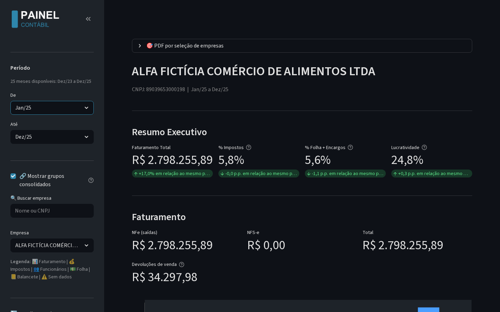
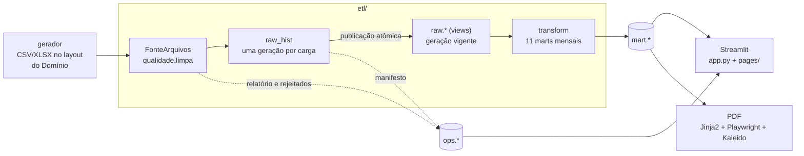
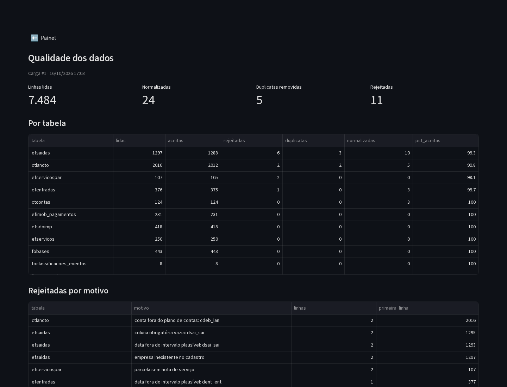

# painel-contabil

Dashboard fiscal/contábil para escritórios de contabilidade que usam o **Domínio**.
Um pipeline ETL leva as tabelas de origem do Domínio para um PostgreSQL,
consolida tudo em marts mensais por empresa e serve um painel Streamlit e um
relatório em PDF por empresa: faturamento, impostos, folha, balancete, DRE e
indicadores.

Este repositório roda **sobre dados sintéticos**. Um gerador determinístico
escreve, no mesmo formato das tabelas do Domínio, cinco empresas fictícias
com 25 meses de movimento, e uma camada de qualidade limpa e valida esses
arquivos antes da carga. Não há dado de cliente aqui.



## Como rodar

Pré-requisito: Docker com `docker compose` (v2).

```bash
git clone <este repositório> && cd painel-contabil
docker compose up
```

Abra **http://localhost:8503**. O `compose` sobe o PostgreSQL, gera os dados
sintéticos, roda o ETL completo (dez/2023 a dez/2025) e só então sobe o painel.
Não precisa de `.env`.

PDF de uma empresa (gerado dentro do container, sai em `./saida/`):

```bash
make pdf EMPRESA=103
```

Também dá para gerar PDFs pelo próprio painel (barra lateral → *Gerar PDF*).

### Docker no macOS

Funciona com **Docker Desktop** ou com **colima** (sem interface gráfica):

```bash
brew install colima docker docker-compose
mkdir -p ~/.docker && echo '{"cliPluginsExtraDirs": ["/opt/homebrew/lib/docker/cli-plugins"]}' > ~/.docker/config.json
colima start --cpu 4 --memory 6
docker compose up
```

A imagem é nativa (arm64 ou amd64), sem emulação. Com colima, clone o
repositório dentro da sua pasta pessoal: por padrão só ela é compartilhada
com a VM, e é por ali que os PDFs chegam em `./saida/`.

### Testes e lint, fora do Docker

```bash
python3.11 -m venv .venv && source .venv/bin/activate
pip install -r requirements-lock.txt
make test      # 1.191 testes, sem serviços
make lint      # ruff, sem exceções por arquivo
PG_HOST=localhost PG_USER=postgres PG_PASS=postgres make test-db   # 52 testes com PostgreSQL
python -m pytest -m chrome     # 3 testes que sobem o Chromium de verdade
```

O CI (`.github/workflows/ci.yml`) roda lint, as duas suítes (a de banco contra
um `postgres:15` de serviço) e um `docker compose up` de ponta a ponta.

## Arquitetura



1. **Fonte.** O orquestrador (`etl/main.py`) lê cada tabela de origem pela
   interface `Fonte` (`etl/fonte/base.py`). Aqui ela é implementada por
   `FonteArquivos`, que lê um CSV ou XLSX por tabela. O contrato de colunas e
   tipos de cada tabela está em `etl/raw_schema.py`.
2. **Qualidade.** Antes do contrato, `etl/qualidade.py` normaliza o que é
   normalizável e rejeita o resto com o motivo (detalhes abaixo).
3. **Raw com gerações.** Cada carga grava uma geração nova em `raw_hist.*`.
   Ela só fica vigente depois de passar pelas guardas: janela, chaves e
   encolhimento. A publicação de todas as tabelas acontece numa única
   transação. `raw.*` são views que mostram só a geração vigente de cada fatia.
4. **Transform.** O transform lê `raw.*` e monta 11 marts mensais por empresa
   em pandas: faturamento, impostos, impostos destacados, regime, folha,
   rubricas, encargos, funcionários, balancete, DRE e empresas.
5. **Consumo.** O painel e o PDF leem só os marts. O PDF usa o mesmo Chromium
   para os gráficos (Kaleido) e para a página (Playwright).

O desenho completo, com as decisões e o porquê de cada uma, está em
[`docs/ARQUITETURA.md`](docs/ARQUITETURA.md).

## Dados sintéticos

`python -m gerador --saida dados` escreve as 20 tabelas de origem para cinco
empresas, de dez/2023 a dez/2025. A semente é fixa, então a saída é sempre a
mesma.

| código | empresa | regime | o que exercita |
|---|---|---|---|
| 101 | Alfa Fictícia Comércio de Alimentos | Simples Nacional | DAS; venda à ordem fora do faturamento; entrega futura com vigência própria; devolução de venda |
| 102 | Beta Fictícia Serviços Técnicos | Lucro Presumido | NFS-e com ISS por guia **e** ISS retido pelo tomador; IRPJ/CSLL pelo passivo |
| 103 | Gama Fictícia Indústria de Embalagens | Lucro Real | ICMS, IPI, PIS/COFINS não cumulativos; IRPJ com adicional; exportação e ST |
| 104 | Delta Fictícia Empreendimentos Imobiliários | Lucro Presumido | recebimentos de venda de imóvel (origens B, L e R) |
| 105 | Gama Fictícia (filial) | Lucro Real | mesma raiz de CNPJ da 103: consolidado de grupo |

A contabilidade (plano de contas e lançamentos) acompanha as notas e a folha.
Por isso balancete, DRE, liquidez e lucratividade fecham com o faturamento.

## Qualidade de dados



O gerador também **suja** os arquivos, de forma determinística e em taxa baixa,
e grava em `_sujeira.json` quanto aplicou de cada tipo:

| tipo de sujeira | o que a carga faz |
|---|---|
| data `31/01/2024`, valor `1.234,56`, CNPJ com máscara, nome com espaços/caixa trocados | **normaliza** e conta |
| linha repetida | **remove** a duplicata e conta |
| ano absurdo, coluna obrigatória ou chave vazia, valor ambíguo (`1.234` sem decimais), empresa fora do cadastro, parcela sem nota de serviço, lançamento em conta fora do plano | **rejeita**, com o motivo |

Nada é descartado em silêncio:

- cada linha rejeitada vai para `ops.rejeitados`, com o número da linha no arquivo, o motivo e o conteúdo original;
- os totais da carga vão para `ops.qualidade_carga`: lidas, aceitas, normalizadas, duplicatas, rejeitadas por motivo e completude por coluna;
- a página *Qualidade dos dados* mostra a última carga.

A limpeza acontece **antes** do raw. Depois dela, o dado aceito é exatamente o
dado limpo, então a regra de negócio do transform não muda e a sujeira não
altera nenhum número do painel. Os testes provam três coisas: o relatório da
carga bate com o manifesto do gerador, o dado aceito é igual ao dado limpo, e
cada tipo de sujeira tem seu próprio caso.

## Onde está o SQL

A transformação é em pandas, e o SQL fica onde ele é a ferramenta certa:

- **Views do raw** (`etl/geracao.py`, `sql_view`): `raw.<tabela>` faz um
  `JOIN` de `raw_hist.<tabela>` com `ops.raw_slice_vigente` e devolve só as
  linhas da geração vigente de cada fatia (empresa × mês).
- **Manifesto das gerações** (`etl/geracao.py`, `DDL_OPS` e `publica`):
  `ops.raw_generation`, `ops.raw_generation_scope` e `ops.raw_slice_vigente`,
  com `CHECK`, `FOREIGN KEY`, índice parcial e upsert por fatia
  (`ON CONFLICT ... DO UPDATE`), tudo numa transação.
- **Verificação da publicação** (`etl/geracao.py`):
  - `verifica_publicacao` agrega `raw_hist` por geração e fatia (`GROUP BY`) e confere com o manifesto;
  - antes de um `--skip-extract`, `detecta_rapido` cruza o vigente com `ops.raw_generation` (`LEFT JOIN`) para achar fatia vigente que aponta para geração inexistente ou não publicada.
- **Leitura consistente** (`etl/main.py`, `run_read_raw`): todas as tabelas
  lidas no mesmo snapshot, em `REPEATABLE READ` somente leitura.
- **Um run por vez** (`etl/main.py`): `pg_try_advisory_lock` de sessão.
- **Cobertura da carteira** (`etl/queries.py`, `SQL_COBERTURA_EMPRESAS`): uma
  linha por empresa, com cinco subconsultas `EXISTS` sobre os marts.
- **Expurgo** (`etl/load.py`, `expurga_geracoes_si`): o único `DELETE` em raw,
  limitado por escopo e com proteção do corte canônico.
- **Alterações retroativas** (`etl/retroativas.py` e
  `pages/alteracoes_retroativas.py`): histórico só de inserção
  (`ON CONFLICT DO NOTHING`), lido com `LEFT JOIN` no cadastro.
- **Relatório de qualidade** (`pages/qualidade_dados.py`):
  - `LEFT JOIN` com `ops.controle_runs`;
  - `GROUP BY` de rejeitados por motivo;
  - subconsulta escalar sobre `jsonb_each_text` para somar normalizações;
  - `CROSS JOIN LATERAL jsonb_each_text(...)` para abrir completude e normalizações por coluna.

## Decisões técnicas

- **A troca de fonte é só no extract.** O pipeline original lê o banco do
  Domínio (SQL Anywhere, via JDBC). Aqui a única implementação da interface
  `Fonte` é a de arquivos. As janelas de cada tabela continuam decididas pelo
  orquestrador (folha e rescisões, por exemplo, leem um mês a mais para trás),
  então nada depois do extract sabe de onde o dado veio.
- **Contrato de tipos explícito.** `raw_schema.TIPOS` reproduz o que o driver
  JDBC entrega: data como texto `YYYY-MM-DD`, valor como float, código como
  inteiro. Uma célula de data do XLSX vira o mesmo texto do CSV. Sem isso, o
  tipo das tabelas do raw mudaria conforme o formato do arquivo.
- **Raw versionado por geração, não sobrescrito.** Uma carga ruim (tabela que
  encolhe mais de 5%, fatia que perde mais de 30%, linha fora da janela,
  chave nula) é rejeitada sem tocar no que está vigente. Para aceitar, é
  preciso liberar explicitamente com `--aceitar-encolhimento` e um motivo.
- **Sem ORM.** SQL direto com `psycopg2`, DDL idempotente e upsert por chave
  de grão em cada mart.
- **Regras de negócio em constantes nomeadas** (`etl/mappings.py`): lista de
  CFOPs de receita, devoluções, entrega futura, famílias de rubrica da folha,
  códigos de imposto. Cada regra tem teste próprio.
- **Versões congeladas.** `requirements-lock.txt` fixa inclusive as
  dependências transitivas. Uma versão mais nova do `starlette`, por exemplo,
  quebra o endpoint de mídia do Streamlit.

Limites conhecidos da versão sintética:

- **Folha mínima.** Não há rescisão, 13º nem GRFC.
- **Primeiro mês da base** (dez/2023). O gráfico de funcionários mostra o
  quadro inteiro como entradas nesse mês, porque é o primeiro mês carregado.

## Desenvolvido com Claude Code

A arquitetura, as regras de negócio e a validação contra a contabilidade real
são minhas. Elas vêm do sistema que construí e opero para um escritório que
usa o Domínio.

A implementação foi feita com o Claude Code, sob minha direção:

- **Antes de alterar código:** investigação somente leitura;
- **Mudanças:** planos com critérios de aceite e testes escritos antes do
  código;
- **Revisão:** comparação de AST para provar que a limpeza de comentários não
  mudou lógica.

Este repositório público foi extraído do sistema privado:

- **Cópia:** só de uma lista de arquivos permitidos, com histórico git novo;
- **Fonte de dados:** o banco do Domínio foi trocado por arquivos sintéticos;
- **Verificação:** gitleaks e uma varredura de nomes, códigos e documentos
  reais, em cada commit.

## Licença

[MIT](LICENSE)
