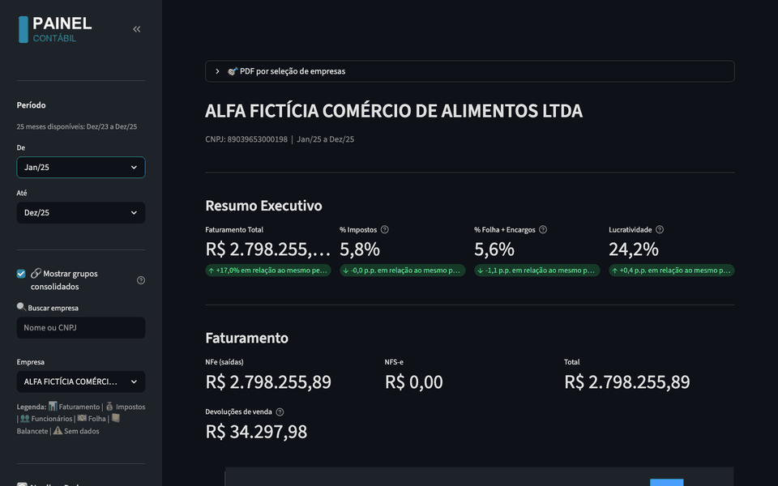
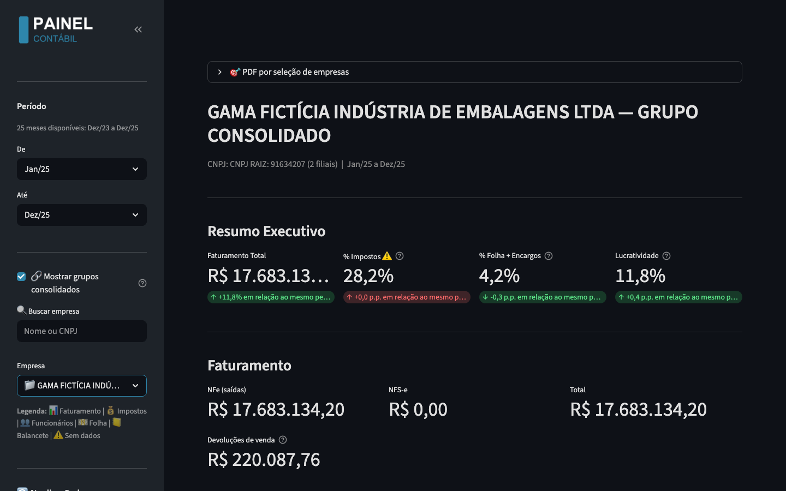
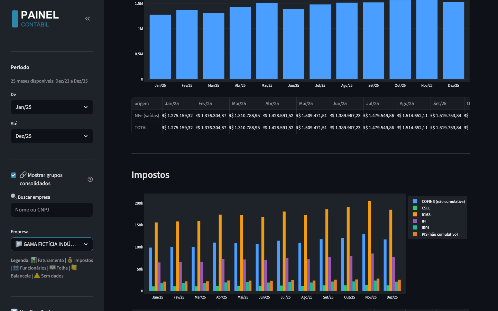
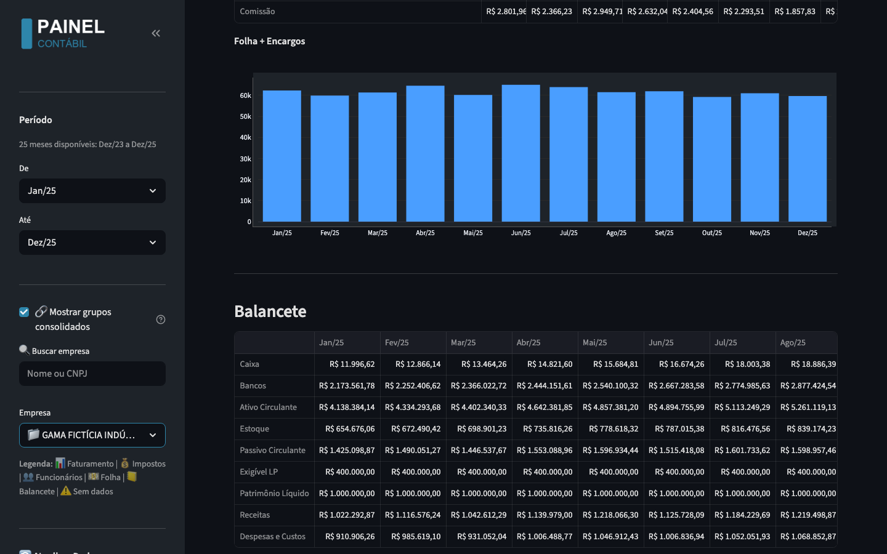
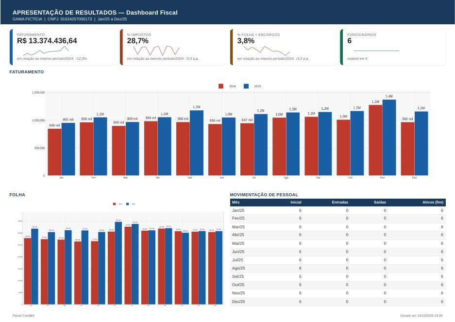
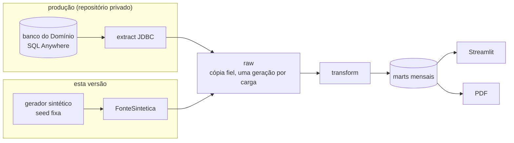

# painel-contabil

Pipeline ETL e dashboard fiscal/contábil para escritórios de contabilidade que usam o Domínio.

[](https://github.com/leirosjose/painel-contabil/actions/workflows/ci.yml)




## O que é

Substitui as planilhas de Excel montadas à mão para apresentar resultados aos
clientes. Em produção, roda num escritório com cerca de 400 empresas ativas:
lê o banco do Domínio, consolida fiscal, contabilidade e folha em marts mensais
e entrega um painel e um PDF por empresa (ou por grupo de empresas com a mesma
raiz de CNPJ).

| | |
|---|---|
|  |  |
| Resumo executivo e faturamento do grupo consolidado | Impostos e folha mês a mês |
|  |  |
| Balancete e indicadores | Página fiscal do PDF por empresa |

## Arquitetura



- **Raw:** cópia fiel das tabelas do Domínio. Cada carga grava uma geração
  nova, que só é publicada depois de validada (janela, chaves, encolhimento).
- **Marts:** 11 tabelas mensais por empresa (faturamento, impostos, folha,
  encargos, funcionários, balancete, DRE...), cada uma com grão explícito.
- **App e PDF espelhados:** os dois leem os mesmos marts e as mesmas séries,
  então o número da tela é o número do PDF.

Nesta versão a fonte é uma interface (`Fonte`): o gerador entrega as tabelas
no mesmo layout e com os mesmos tipos do Domínio, e do raw em diante o código
é o mesmo da produção. Detalhes em [`docs/ARQUITETURA.md`](docs/ARQUITETURA.md).

## Problemas reais e como resolvi

- **Origem que regenera chaves.** Ao reprocessar, o sistema contábil apaga e
  recria lançamentos com chave nova. A cópia histórica guardava as duas
  versões, e o reprocessamento dobrava valores em silêncio. Solução: carimbo
  de geração por linha e manifesto de cargas; uma carga só é publicada depois
  de validada. Prova: um gate que exige marts idênticos entre a carga completa
  e o reprocessamento.
- **Faturamento que não batia com o relatório oficial.** A diferença era
  devolução de venda. O faturamento passou a ser líquido de devolução,
  abatida no mês da nota de entrada, e bate com o relatório do Domínio.
- **Gráfico trocado entre PDFs.** Duas sessões gerando PDF ao mesmo tempo
  trocavam a imagem do gráfico entre empresas, sem erro. Solução: lock na
  geração das imagens e teste de concorrência.
- **Atualização automática do navegador quebrou o PDF em produção.**
  Solução: Chromium pinado e caminho resolvido no código.
- **Watchdog que não via o app quebrado.** O health respondia 200 com o app
  em erro, e o script de restart chegou a derrubar outro sistema da mesma
  máquina. Solução: restart filtrado pela porta do app.
- **Soma em ponto flutuante não determinística no Postgres.** A agregação
  paralela reordena as parcelas. Os gates passaram a somar em `numeric`
  arredondado.
- **Teste que cristalizou um defeito.** Um teste que media a tela de hoje
  travou um comportamento errado. Regra adotada: o esperado vem da regra de
  negócio, nunca da tela atual.

## Como rodar

```bash
git clone https://github.com/leirosjose/painel-contabil.git
cd painel-contabil
docker compose up
```

Abra **http://localhost:8503**. Requisito: Docker (Docker Desktop no Windows
e no macOS). Os dados são fictícios, gerados com seed fixa; qualquer
coincidência com empresa real é acaso.

PDF de uma empresa, gerado no container e salvo em `./saida/`:

```bash
make pdf EMPRESA=103
```

<details>
<summary>macOS sem Docker Desktop</summary>

```bash
brew install colima docker docker-compose
mkdir -p ~/.docker && echo '{"cliPluginsExtraDirs": ["/opt/homebrew/lib/docker/cli-plugins"]}' > ~/.docker/config.json
colima start --cpu 4 --memory 6
docker compose up
```

Clone o repositório dentro da sua pasta pessoal: por padrão o colima só
compartilha ela com a VM, e é por ali que os PDFs chegam em `./saida/`.
</details>

## Testes e CI

| suíte | testes | precisa de |
|---|---|---|
| unitários (`make test`) | 1.165 | nada |
| com banco (`make test-db`) | 48 | PostgreSQL |
| navegador (`pytest -m chrome`) | 3 | Chromium |

O CI roda lint (ruff, sem exceções por arquivo), as duas suítes (a de banco
contra um `postgres:15`), um `docker compose up` de ponta a ponta e, no push
da `main`, publica a imagem multi-arquitetura (amd64 e arm64) no GHCR, que é
a que o `compose` baixa.

## Stack e decisões

- Python 3.11, pandas, psycopg2 sem ORM, PostgreSQL 15, Streamlit, Plotly,
  Jinja2 + Playwright para o PDF, Docker.
- **Regra de negócio como dado nomeado num lugar só** (`etl/mappings.py`):
  CFOPs de receita, devoluções, entrega futura, famílias de rubrica da folha,
  códigos de imposto, cada uma com teste.
- **Ausência declara:** mês sem dado mostra "—", nunca 0.
- **Versões congeladas:** `requirements-lock.txt` fixa até as dependências
  transitivas.

## Desenvolvido com Claude Code

A arquitetura, as regras de negócio e a validação contra a contabilidade real
são minhas. Elas vêm do sistema que construí e opero para um escritório que
usa o Domínio.

A implementação foi feita com o Claude Code, sob minha direção:

- **Antes de alterar código:** investigação somente leitura;
- **Mudanças:** planos com critérios de aceite e testes escritos antes do
  código;
- **Revisão:** comparação de AST para provar que a limpeza de comentários não
  mudou lógica.

Este repositório público foi extraído do sistema privado:

- **Cópia:** só de uma lista de arquivos permitidos, com histórico git novo;
- **Fonte de dados:** o banco do Domínio foi trocado por um gerador sintético;
- **Verificação:** gitleaks e uma varredura de nomes, códigos e documentos
  reais, em cada commit.

---

Copyright (c) 2026 José Leiros. Todos os direitos reservados. Código publicado
para avaliação de portfólio.
