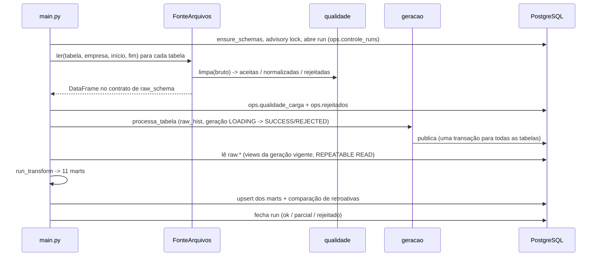

# Arquitetura

## Contexto

Escritórios de contabilidade que usam o Domínio têm o dado fiscal, contábil e
de folha de centenas de empresas no banco do sistema, mas não uma visão
mensal consolidada por cliente para reunião. Este projeto lê as tabelas de
origem, calcula indicadores mensais por empresa e os apresenta num painel e
num PDF.

Neste repositório a origem são arquivos sintéticos no layout das tabelas do
Domínio. O resto do pipeline é o mesmo da versão que lê o banco.

## Componentes

| caminho | papel |
|---|---|
| `gerador/` | dados sintéticos determinísticos (5 empresas, dez/2023 a dez/2025) e sujeira de qualidade |
| `etl/fonte/` | interface `Fonte` e a implementação `FonteArquivos` (CSV/XLSX) |
| `etl/raw_schema.py` | contrato de colunas e tipos de cada tabela de origem, janela por tabela |
| `etl/qualidade.py` | limpeza na entrada: normaliza, rejeita com motivo, mede completude |
| `etl/raw_escopo.py` | escopo de cada tabela no raw: fatia (empresa × mês) e pedido do run |
| `etl/geracao.py` | gerações do raw: gravação, guardas, manifesto, publicação, detector |
| `etl/load.py` | DDL idempotente, upsert de marts, expurgo de gerações antigas |
| `etl/transform.py` | raw → 11 marts mensais |
| `etl/metrics.py` | séries e KPIs do painel e do PDF (módulo puro, sem banco) |
| `etl/retroativas.py` | detecta número de mês fechado que mudou entre cargas |
| `etl/main.py` | orquestrador (CLI) |
| `app.py`, `pages/` | painel Streamlit, página de alterações retroativas, página de qualidade |
| `pdf_generator.py`, `templates/` | PDF por empresa: Jinja2 → HTML → Playwright; gráficos via Kaleido |

## Fluxo de uma carga

## Decisões

### 1. A fonte é uma interface; a janela é do orquestrador

`run_extract` mantém a lista de tabelas e a janela de cada uma. A folha e as
rescisões leem um mês a mais para trás, porque o quadro do primeiro mês
depende do mês anterior. A `Fonte` só sabe ler uma tabela numa janela.

Trocar o banco do Domínio por arquivos foi uma mudança local: nada depois do
extract sabe de onde o dado veio.

### 2. Contrato de tipos igual ao do driver da origem

O driver JDBC do Domínio entrega data como texto, valor decimal como float e
código como inteiro (float se a coluna tiver nulo no lote). O loader cria as
tabelas do raw a partir do tipo do DataFrame. Se cada fonte entregasse um tipo
diferente, a mesma tabela teria esquemas diferentes conforme a origem.

`raw_schema.TIPOS` fixa o contrato, e `FonteArquivos` converte para ele,
inclusive células de data do XLSX.

### 3. Raw versionado por geração

Cada carga grava as linhas numa geração nova de `raw_hist.<tabela>`, com
colunas técnicas `_generation_id` e `_fatia`. A geração só passa a valer depois
de validada:

- nenhuma linha fora da janela pedida;
- nenhuma chave nula;
- nenhuma fatia (empresa × mês) com 20 linhas ou mais que perca mais de 30%;
- nenhuma tabela que perca mais de 5% em relação à geração vigente.

Se falhar, a geração fica `REJECTED` e o vigente não muda. O run sai com
código 3, a menos que alguém libere explicitamente com
`--aceitar-encolhimento TABELA --motivo "..."`; o motivo fica gravado no
manifesto.

A publicação de todas as tabelas de um run acontece numa transação só
(`ops.raw_slice_vigente`), e `raw.<tabela>` é uma view sobre a geração
vigente. Quem lê o raw vê um run inteiro ou nenhum. O transform sempre lê das
views, tanto na carga completa quanto no `--skip-extract`, então os dois
caminhos produzem o mesmo resultado por construção.

### 4. Qualidade antes do raw, nunca dentro do transform

A limpeza acontece na fonte e devolve o dado no contrato do raw. O transform
continua recebendo exatamente o que receberia de um banco limpo.

O que não dá para consertar é rejeitado com motivo e guardado com a linha
original (`ops.rejeitados`). O que dá para consertar é normalizado e contado
(`ops.qualidade_carga`). Duplicata exata é removida e contada.

### 5. Marts mensais por empresa, com grão explícito

Cada mart tem uma chave de grão (`MART_KEYS` em `etl/main.py`). Os marts com
competência são gravados com DELETE escopado por (empresa, competência)
seguido de INSERT. Assim, um mês
recalculado nunca deixa linha velha.

O painel e o PDF leem só os marts, e as séries vêm todas de `etl/metrics.py`.
Painel e PDF não podem divergir no mesmo número.

| mart | grão |
|---|---|
| `faturamento_mensal` | empresa, mês |
| `impostos_mensais` | empresa, mês, código do imposto |
| `impostos_destacados_mensais` | empresa, mês |
| `empresa_regime_periodo` | empresa, mês |
| `folha_mensal` | empresa, tipo de processamento, mês |
| `folha_rubricas_mensais` | empresa, mês, tipo de processamento, rubrica |
| `encargos_mensais` | empresa, mês |
| `funcionarios_mensal` | empresa, mês |
| `balancete_mensal` | empresa, mês, conta |
| `dre_mensal` | empresa, mês |
| `empresas` | empresa |

### 6. Regras de negócio como dado, com teste

As listas que decidem o que é receita, devolução, entrega futura, imposto
próprio ou retenção de terceiros, e a família de cada rubrica da folha, são
constantes nomeadas em `etl/mappings.py`, e cada uma tem teste. Exemplos:

- venda à ordem (CFOP 5923) não é faturamento;
- a devolução abate o faturamento no mês da nota de entrada;
- ISS por guia e ISS retido pelo tomador são disjuntos e somam;
- as linhas da folha se agrupam pela classificação da rubrica, nunca pelo
  código do evento, que muda de empresa para empresa.

### 7. Um Chromium para os dois motores do PDF

O HTML do relatório vira PDF no Playwright, e os gráficos viram PNG no
Kaleido. Os dois usam o Chromium que o Playwright instala, inclusive em
Linux arm64, onde o Kaleido não tem Chrome próprio. O servidor do Kaleido é
reaproveitado entre gráficos e tem watchdog: se travar, cai para renderização
avulsa e, por último, para PDF sem gráfico, sem derrubar o painel.

## Testes

| seleção | o que cobre | precisa de |
|---|---|---|
| `-m "not db and not chrome"` | transform, metrics, mappings, load (mock), geração, qualidade, gerador, fonte, painel (fonte do código), PDF (renderização mockada), pipeline inteiro em memória sobre o dado sintético | nada |
| `-m db` | gerações e publicação, lock do run, upsert e expurgo, retroativas, páginas lidas do banco | PostgreSQL (um banco descartável por teste) |
| `-m chrome` | Kaleido e Playwright de verdade | Chromium |

O teste de ponta a ponta em memória (`tests/test_pipeline_sintetico.py`) passa
os arquivos sujos pela fonte e pelo transform e confere três coisas:

- os 11 marts saem preenchidos para as cinco empresas;
- nenhuma coluna de valor sai como texto;
- as regras de regime e de ISS aparecem no resultado.
